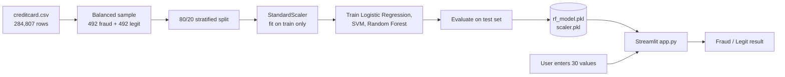

<div align="center">

# 💳 Credit Card Fraud Detection

**A machine learning project that classifies credit card transactions as fraudulent or legitimate, with a Streamlit web interface.**


[Overview](#-overview) · [Results](#-model-results) · [Setup](#-installation-and-setup) · [Limitations](#-current-limitations) · [Roadmap](#-future-enhancements)

</div>

---

## 📖 Overview

This project trains and compares three classification models (Logistic Regression, SVM and Random Forest) on the public credit card transactions dataset, then serves the best one, a Random Forest, through a small Streamlit app.

The repository contains:

| Part | File | Description |
| --- | --- | --- |
| Experiment | `Credit_Card_Fraud_Detection.ipynb` | Data exploration, preprocessing, model training and evaluation |
| Web app | `app.py` | Streamlit form that loads the saved model and predicts one transaction |
| Saved model | `rf_model.pkl` | Trained Random Forest (500 trees) |
| Saved scaler | `scaler.pkl` | `StandardScaler` fitted on the training data |

> **Project note:** The model is trained on a small, balanced sample (984 rows) and evaluated on 197 rows, so the scores below do **not** represent how it would perform on real, highly imbalanced transaction traffic. The app is a demonstration prototype, not a production fraud-detection system. See [Current Limitations](#-current-limitations).

## 🎯 Problem Statement

Fraudulent transactions are extremely rare compared with legitimate ones. In the dataset used here, only 492 of 284,807 transactions (about 0.17%) are fraud. This imbalance makes it hard to train a model that catches fraud without flagging large numbers of genuine purchases.

## ✅ Project Objectives

- Explore the dataset and confirm its quality (shape, data types, missing values, class balance).
- Handle the class imbalance by building a balanced sample.
- Train and compare Logistic Regression, SVM and Random Forest classifiers.
- Evaluate with accuracy, precision, recall, F1-score and confusion matrices.
- Save the best model and expose it through a simple web interface.

## ✨ Key Features

| Feature | Status |
| --- | :---: |
| Exploratory analysis: shape, columns, data types, missing values, class distribution | ✅ |
| Stratified train/test split and `StandardScaler` fitted on training data only | ✅ |
| Balanced sample: all 492 fraud rows plus 492 randomly chosen legitimate rows | ✅ |
| Comparison of three models with classification reports and confusion matrices | ✅ |
| Model and scaler saved with `pickle` | ✅ |
| Streamlit app with 30 numeric inputs and a **Detect Fraud** button | ✅ |
| Fraud probability or risk score in the app | ❌ not implemented |
| Handling of the full imbalanced dataset in the final model | ❌ not implemented |

## 📊 Model Results

All results come from the notebook's saved outputs, on the **balanced 197-row test set** (99 legitimate, 98 fraud).

| Model | Settings | Accuracy | Fraud precision | Fraud recall | Fraud F1 |
| --- | --- | :---: | :---: | :---: | :---: |
| Logistic Regression | `max_iter=1000`, `class_weight='balanced'` | 93.4% | 0.95 | 0.92 | 0.93 |
| SVM | RBF kernel, `class_weight='balanced'` | 92.4% | 0.97 | 0.88 | 0.92 |
| **Random Forest** (saved model) | `n_estimators=500`, `class_weight='balanced'`, `random_state=42` | **93.9%** | 0.96 | 0.92 | 0.94 |

Random Forest confusion matrix (rows = actual, columns = predicted):

|  | Predicted legit | Predicted fraud |
| --- | :---: | :---: |
| **Actual legit** | 95 | 4 |
| **Actual fraud** | 8 | 90 |

> ⚠️ The three models differ by only a few test samples, so the ranking is not statistically strong. The test set is small and balanced, so these figures should not be read as real-world accuracy.

## 🧰 Technology Stack

| Area | Tools |
| --- | --- |
| Language | Python 3 |
| Data handling | pandas, NumPy |
| Machine learning | scikit-learn (`LogisticRegression`, `SVC`, `RandomForestClassifier`, `StandardScaler`, `train_test_split`) |
| Web interface | Streamlit |
| Model storage | `pickle` |
| Development environment | Jupyter / Google Colab (the notebook mounts Google Drive) |

## 🏗️ System Architecture



## 📁 Project Folder Structure

```
Credit_Card_Fraud_Detection/
├── app.py                              # Streamlit web app
├── Credit_Card_Fraud_Detection.ipynb   # EDA, training and evaluation
├── rf_model.pkl                        # Saved Random Forest model
├── scaler.pkl                          # Saved StandardScaler
├── requirements.txt                    # Python dependencies
├── docs/screenshots/                   # README screenshots go here
└── README.md
```

The dataset file `creditcard.csv` is **not** included in this repository (see [Dataset](#-dataset-and-attribution)).

## ⚙️ Installation and Setup

### Prerequisites

- Python 3.9 or later
- `pip`
- Git

### Steps

```bash
# 1. Clone the repository
git clone https://github.com/<your-username>/Credit_Card_Fraud_Detection.git
cd Credit_Card_Fraud_Detection

# 2. (Recommended) create a virtual environment
python -m venv venv
source venv/bin/activate        # Windows: venv\Scripts\activate

# 3. Install dependencies
pip install -r requirements.txt
```

> **Why scikit-learn is pinned:** the `.pkl` files were saved with scikit-learn **1.6.1**. Loading them with a different version shows a warning and may produce errors or incorrect results.

## ▶️ How to Run the Project

### Run the web app

```bash
streamlit run app.py
```

Streamlit opens the app in your browser (by default at `http://localhost:8501`). Enter values for the 30 features and click **Detect Fraud**.

### Re-run the notebook

1. Download `creditcard.csv` (see [Dataset](#-dataset-and-attribution)).
2. Open `Credit_Card_Fraud_Detection.ipynb`.
3. Replace the Google Colab lines at the top (the `drive.mount(...)` cell and the `/content/drive/MyDrive/Colab Notebooks/creditcard.csv` path) with the local path to your CSV, for example `pd.read_csv("creditcard.csv")`.
4. Run all cells. The last cells regenerate `rf_model.pkl` and `scaler.pkl`.

## 🔐 Environment Variables and Configuration

No environment variables or API keys are required. The only configuration is the pinned scikit-learn version in `requirements.txt`, and the dataset path inside the notebook.

## 🔌 API Integration

None. The app loads the model files directly and does not expose or call any API.

## 🖼️ Application Screenshots

> Screenshots have not been added yet. Add images to `docs/screenshots/` and update the paths below.

| Streamlit app | Prediction result |
| :---: | :---: |
|  |  |

## 📚 Dataset and Attribution

The notebook expects the **Credit Card Fraud Detection** dataset (`creditcard.csv`), which has 284,807 transactions and 31 columns: `Time`, `V1`–`V28`, `Amount` and `Class` (0 = legitimate, 1 = fraud). `V1`–`V28` are anonymised features, and the notebook's output shows no missing values.

The dataset is third-party data and is not my original work. It is published on Kaggle by the ULB Machine Learning Group, in collaboration with Worldline. **[Add the exact Kaggle link and check the dataset's license and citation requirements before publishing.]**

## ⚠️ Current Limitations

| Area | Limitation |
| --- | --- |
| **Training data size** | The final model is trained on only 787 rows (80% of 984) and tested on 197 rows. Most of the 284,807 transactions are discarded by undersampling |
| **Evaluation** | The test set is balanced 50/50, while real fraud is about 0.17% of transactions. Precision on real traffic would be much lower than reported here. The notebook does not evaluate the model on the full imbalanced test set, and does not report ROC-AUC or precision-recall curves |
| **Unused work** | The notebook also builds a full-dataset split and scaler (`X_train_scaled`), but they are never used for training |
| **Usability** | The app asks for 30 raw values, including 28 anonymised PCA features (`V1`–`V28`) that a real user cannot know. In practice it can only test rows copied from the dataset |
| **App output** | It shows only "Fraud" or "Legit", with no probability and no adjustable threshold |
| **Warnings** | The scaler was fitted on a DataFrame, but the app passes a NumPy array, so scikit-learn prints a feature-name warning. It does not stop the app |
| **Reproducibility** | The notebook depends on Google Colab and Google Drive paths, and the dataset is not in the repo |
| **Model files** | Loaded with `pickle`, which can run arbitrary code. Only load `.pkl` files from sources you trust |
| **Testing** | No automated tests, no hyperparameter tuning and no cross-validation |

## 🚀 Future Enhancements

Planned ideas, **not yet implemented**:

- [ ] Train and evaluate on the full imbalanced dataset using class weights or SMOTE, with ROC-AUC and precision-recall metrics
- [ ] Add cross-validation and hyperparameter tuning
- [ ] Show fraud probability and let the user choose a decision threshold
- [ ] Add CSV upload for batch predictions
- [ ] Replace manual feature entry with sample rows or a demo transaction picker
- [ ] Save the model with `joblib` and include the scikit-learn version in the model metadata
- [ ] Add unit tests and a GitHub Actions workflow
- [ ] Deploy the app (for example on Streamlit Community Cloud)

## 🤝 Contributing

Contributions and suggestions are welcome.

1. Fork the repository
2. Create a branch: `git checkout -b feature/your-feature-name`
3. Commit your changes: `git commit -m "Add: short description"`
4. Push the branch: `git push origin feature/your-feature-name`
5. Open a Pull Request describing what changed and why

## 📄 License

No license has been chosen yet. Add a `LICENSE` file (for example MIT) before publishing. Note that the dataset has its own license.

## 👤 Author and Credits

**Author:** [Your Name](https://github.com/your-github-username)

**Credits:**
- Dataset: ULB Machine Learning Group / Worldline, via Kaggle (see [Dataset](#-dataset-and-attribution))
- Libraries: [scikit-learn](https://scikit-learn.org/), [pandas](https://pandas.pydata.org/), [NumPy](https://numpy.org/), [Streamlit](https://streamlit.io/)

---

<div align="center">

If you find this project useful, consider giving it a ⭐

</div>
